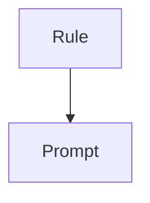

> ◇ NOTE
>
> The body points at [[llm-wiki]].

> A plain quote stays a callout.

| Rule type | When it is included |
| --- | --- |
| Always Apply | Every chat session, even when the table is wider than the reading column and has to scroll |

See `alwaysApply`, then the next word.
